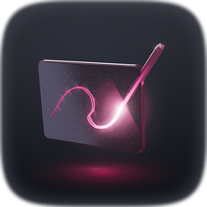

# Grok Bot templates

A catalog of open Grok Bot templates you can copy, each with its own kit of scripts and starter files where the bot needs tools. Everything here is plain text and MIT-licensed, so you can read a bot before you install it and change it afterwards.

Made by X [@_marc_garcia](https://x.com/_marc_garcia) (GitHub [Markcial](https://github.com/Markcial)). Motion reel: [pinned post on X](https://x.com/_marc_garcia/status/2113096742115614783).

## The bots

<table>
<tr>
<td width="50%" valign="top" align="center">
 
<b><a href="distributed-workforce-router">Distributed Workforce Router</a></b> 
 
Coordinates your bots. Does the task itself, recommends a template from this catalog, or drafts a new bot for a job that keeps coming back. 
<a href="https://x.ai/bot/79dGJd9FqqNXZZ773YhX8">Use this template</a> · <a href="distributed-workforce-router/media/router-16x9.mp4">Video</a>
</td>
<td width="50%" valign="top" align="center">
 
<b><a href="perpetual-learning-machine">Perpetual Learning Machine</a></b> 
 
Studies what you already read on X, teaches the strongest topic, and keeps every other open topic on a radar. It never writes to X. 
<a href="https://x.ai/bot/PsppjjXTB3Ggf0YmCTlNO">Use this template</a> · <a href="perpetual-learning-machine/media/plm-16x9.mp4">Video</a>
</td>
</tr>
<tr>
<td width="50%" valign="top" align="center">
 
<b><a href="superconnected-research-entity">Superconnected Research Entity</a></b> 
 
Researches a question, compares the free options, runs small experiments, and reports with a source for every claim. 
Template not published yet · <a href="superconnected-research-entity/media/sre-16x9.mp4">Video</a> · <a href="superconnected-research-entity/kit">Kit</a>
</td>
<td width="50%" valign="top" align="center">
 
<b><a href="methodical-visual-synthesizer">Methodical Visual Synthesizer</a></b> 
 
Helps you create and track your brand with a living brand book, then designs images, avatars, social visuals, motion videos and explainers. 
Template not published yet · <a href="methodical-visual-synthesizer/media/mvs-16x9.mp4">Video</a> · <a href="methodical-visual-synthesizer/kit">Kit</a>
</td>
</tr>
</table>

Stage `launch` means the template is published and has a link. Stage `prepare` means the text, avatar and videos exist, but the template is not published yet.

## How a template works

Every bot here follows the same three steps:

1. **Diagnose.** Before it does real work, the bot asks what it needs to know and writes a short diagnosis.
2. **Your OK.** It waits for you to approve or change that diagnosis. Silence is not approval.
3. **Build.** Only then does it do the work, using free tools first. It tells you about any cost before it suggests a step that has one.

Nothing is published, sent, bought or contacted without your explicit yes to that specific action. Templates hold no personal data, accounts or secrets.

## Kits

A template can carry only text. A bot that needs tools gets a **kit**: a `kit/` folder in this repo with `setup.sh`, `doctor.sh` (a self-check) and a README. On its first run the bot fetches only its own kit, asks before installing anything, runs the setup and the self-check, and shows you the result. Kits are free to run by default.

| Bot | What the kit holds |
| --- | --- |
| [Methodical Visual Synthesizer](methodical-visual-synthesizer/kit) | Remotion project for 16:9 video from one JSON config, code-drawn avatars, free narration with a silent fallback, a music bed, a brand book template with a contrast and licence check, and a video QA script |
| [Superconnected Research Entity](superconnected-research-entity/kit) | Experiment scaffold, report template, link checker, doctor |

More detail is under [Kits (technical)](#kits-technical) below.

## Try one

- **Launched bots:** open [Distributed Workforce Router](https://x.ai/bot/79dGJd9FqqNXZZ773YhX8) or [Perpetual Learning Machine](https://x.ai/bot/PsppjjXTB3Ggf0YmCTlNO) and follow the link to add it to your Grok Bot.
- **Bots in `prepare`:** read the folder (`profile.md`, `getting-started.md`, `skills/`) and watch the video. They are not published yet, so there is no install link.
- **Your own bot:** copy `_template/` and follow [Use a template](#use-a-template).

## Stages

A bot moves one way: **sketch** (the text is in this repo), **prepare** (the text is stable and the avatar and video are being made and reviewed), **ready** (everything is finished, still unpublished) and **launch** (the template is published once and gets a share link). The exit criteria for each stage are in [Pipeline](#pipeline).

## Videos

| Bot | 16:9 | 1:1 |
| --- | --- | --- |
| Distributed Workforce Router | [router-16x9.mp4](distributed-workforce-router/media/router-16x9.mp4) | [router-1x1.mp4](distributed-workforce-router/media/router-1x1.mp4) |
| Perpetual Learning Machine | [plm-16x9.mp4](perpetual-learning-machine/media/plm-16x9.mp4) | [plm-1x1.mp4](perpetual-learning-machine/media/plm-1x1.mp4) |
| Superconnected Research Entity | [sre-16x9.mp4](superconnected-research-entity/media/sre-16x9.mp4) | [sre-1x1.mp4](superconnected-research-entity/media/sre-1x1.mp4) |
| Methodical Visual Synthesizer | [mvs-16x9.mp4](methodical-visual-synthesizer/media/mvs-16x9.mp4) | [mvs-1x1.mp4](methodical-visual-synthesizer/media/mvs-1x1.mp4) |

Avatars and videos were made in code. The bed music licence is in [`LICENSE-music.md`](LICENSE-music.md).

---

## For maintainers

Templates for Grok bots: description, skills, seed memories, routines, and a getting-started note. `catalog.json` is the machine-readable list a coordinator bot reads when it picks or recommends a template. Installed bots fetch it at `https://raw.githubusercontent.com/Markcial/bots/main/catalog.json`. If that fetch fails, they ask for a paste or another URL. They do not invent entries. Text here is generic. It holds no personal memories, contact details, or secrets.

Layout: one folder per bot (`profile.md`, `getting-started.md`, `memories.md`, `routines.md`, `skills/`, `media/`, and `kit/` where needed), plus `_template/`, `catalog.json` and `LICENSE`. The code and text are MIT-licensed ([`LICENSE`](LICENSE)); the bed music has its own terms in [`LICENSE-music.md`](LICENSE-music.md).

### Use a template

1. Copy `_template/` to a new folder. The folder name is the kebab-case form of the bot's three-word title (buzzword, domain, role), for example `distributed-workforce-router`.
2. Replace every placeholder in `profile.md`, `getting-started.md`, `memories.md`, `routines.md`, and `skills/`.
3. Add an object to `catalog.json` and a row to the catalog table below. Leave `xai_template_url` null until launch.
4. Keep the stage at `sketch` until that stage's exit criteria are met.
5. This repo is the source of truth for the words. To install a shared template in Grok Bot, open `grokbot://app/v1/bot-template?id=<share id>`. How a share id is created is confirmed at launch. Until then, create the bot from `profile.md`, add each skill with its YAML frontmatter, paste `memories.md` as seed knowledge, and schedule every routine with its 5-field cron in the user's timezone. The routine delivers in that chat. Put the avatar and the motion presentation video in `media/` during `prepare`.
6. At `launch`, publish the Grok Bot template once, with that avatar and motion video. The result is a shareable `grokbot://app/v1/bot-template?id=<share id>` link. Set `xai_template_url` to that link. A bot does not create another bot. It hands the user a draft and, when they have a share id, that same link.

Planned names in the table have no folder. Do not assign work to them and do not add them to `catalog.json`.

### Kits (technical)

A Grok Bot template carries only prose: the profile, seed memories, skill text, routines, and a getting-started note. It cannot carry files or scripts. So a bot that needs tools gets a **kit**: a `kit/` folder inside its template folder, in this public repo (MIT).

1. **Template plus kit.** The template installs the bot. The kit holds the harness the bot needs on its own computer: `setup.sh` (checks for or installs the toolchain and prints what is missing), `doctor.sh` (a self-check that proves the toolchain works), a `README.md` written for the bot, and whatever scripts or starter projects the job needs.
2. **First run.** Step 1 of every kit bot's getting-started note is "set up your workspace". The skill `setup-workspace` makes the bot fetch only its own `<folder>/kit` from this repo (a sparse git checkout, or a tarball of `main`), copy it to a workspace folder, run `setup.sh` and then `doctor.sh`, show the owner the test output, and save the folder path in the memory note `workspace-path`. It asks before it installs anything, and it stops if a step needs a paid account.
3. **Rules.** A kit is generic: no personal data, no accounts, no secrets, no owner files. It is free to run by default. Anything paid is optional, needs the owner's explicit yes with the cost stated first, and is never the default path. Every third-party tool and its licence is listed in the kit (`LICENSES.md`). `setup.sh` is idempotent. Nothing in a kit publishes, sends, buys, or contacts anyone.
4. **Updating.** Kits are versioned with the repo. The bot records the commit it fetched in `workspace-path`. To update, it fetches into a new folder and compares, so it never overwrites the owner's work.
5. **Adding a kit to a bot.** Create `<folder>/kit/` with `setup.sh`, `doctor.sh`, and `README.md`. Add a `setup-workspace` skill (copy one from an existing kit bot and change the folder name), make setting up step 1 of `getting-started.md`, and mention the workspace in `profile.md` and `memories.md`. Test from a clean copy in a temporary folder: `setup.sh` then `doctor.sh` must pass.

| Bot | Kit | What it holds |
| --- | --- | --- |
| Methodical Visual Synthesizer | [`methodical-visual-synthesizer/kit`](methodical-visual-synthesizer/kit) | Remotion project (16:9 video from one JSON config, code-drawn avatar still), free narration with silent fallback, built-in music bed with ducking, brand book template with contrast and licence check, video QA script (size, loudness), doctor clip and still |
| Superconnected Research Entity | [`superconnected-research-entity/kit`](superconnected-research-entity/kit) | Experiment scaffold, report template, link checker, doctor |

### Pipeline

A bot moves one way: sketch, prepare, ready, launch. It launches only once, by publishing the Grok Bot template: a shareable `grokbot://app/v1/bot-template?id=<share id>` link, together with its identity (avatar) and a motion presentation video.

| Stage | What is true | Exit criteria |
| --- | --- | --- |
| sketch | The template text is in this repo. Nothing is published. | Profile, getting-started, skills, memories, and routines describe one bot and agree with each other. |
| prepare | The text is stable. Avatar and motion presentation video are being made. | Both files are in `media/` and have been reviewed. |
| ready | Template, avatar, and motion video are finished. Still unpublished. | Someone can publish without writing new copy. |
| launch | The Grok Bot template is published as a shareable `grokbot://app/v1/bot-template?id=<share id>` link, with that avatar and motion video. | `xai_template_url` is set to that link. This happens once. |

`catalog.json` fields: `id`, `title`, `stage`, `summary`, `folder`, `xai_template_url` (or null), `chains_with` (ids of templates that follow this one in a known sequence).

### Catalog

| Name | Stage | One-liner | Template |
| --- | --- | --- | --- |
| Distributed Workforce Router | launch | Does a task itself, recommends a catalog template, or proposes a new bot, and asks what the other bot needs before assigning work. Nothing is sent, published, purchased, or contacted without an explicit yes. | [Open template](https://x.ai/bot/79dGJd9FqqNXZZ773YhX8) |
| Perpetual Learning Machine | launch | Reads X likes, bookmarks, replies, posts, and follow topics into a backlog, teaches the strongest open topic, and lists every other open topic in a cited next-day digest. Never likes, replies, follows, or posts. | [Open template](https://x.ai/bot/PsppjjXTB3Ggf0YmCTlNO) |
| Superconnected Research Entity | prepare | Researches a question, compares the options (free first), runs small experiments, and reports the tradeoffs with a cited source for every claim. Flags any cost. Buys, signs up, sends, or contacts no one without an explicit yes. | not published yet |
| Methodical Visual Synthesizer | prepare | Helps you create and track your brand (a living brand book) and designs on top of it: avatars, images, social visuals, motion videos, explainers. A mandatory diagnosis (brief, audience, existing assets, constraints, references) and your OK come before any design. Free tools and code first. Title is a proposal. | not published yet |
| Programmer bot (title not set) | planned | Careful sketch. A mandatory diagnosis phase comes before any code change. No folder yet. | not published yet |
| Perpetual Narrative Weaver | planned | Scripts and storyboards. First step of the creative chain. No folder yet. | not published yet |
| Distributed Character Sculptor | planned | Characters for those scripts. No folder yet. | not published yet |
| Continuous Motion Composer | planned | Motion design for those characters. No folder yet. | not published yet |
| Hyperconnected Audio Producer | planned | Audio and voice for that motion. No folder yet. | not published yet |
| Animation bot (name TBD) | planned | Turns the chain into a finished piece. Name not chosen. No folder yet. | not published yet |

The creative block, once those templates exist, runs in this order: Perpetual Narrative Weaver, Distributed Character Sculptor, Continuous Motion Composer, Hyperconnected Audio Producer, then the animation bot. Each hands its output to the next. They are not in `catalog.json` until they have folders.
